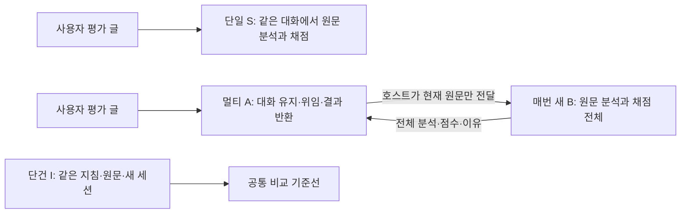

# Agent Context Experiments

**대화 이력을 유지하는 단일 평가자와, 사용자 대화 담당·독립 평가자를 분리한 구조에서 채점이 어떻게 달라지는지 비교한 연구다.** 한국어 합성 평가문을 사용하며, 점수는 사람의 성과가 아니라 글의 논증 품질을 나타내는 0–12점이다.

이 저장소는 **수정된 v4 설계의 동질 이력·교대 이력 두 실험**을 담는다. 이전 공개본의 ‘지속 분석가 + 새 점수 판정가’ 구조와 기록 재생 실험은 현재 자료에서 제외했다. 이전 커밋은 보존하며 [설계 변경 이유](docs/STUDY_HISTORY.md)에 구분했다.

## 무엇을 비교했나



B는 A가 작성한 분석문을 받아 점수만 매기는 역할이 아니다. **현재 원문을 직접 분석하고 채점한다.** A는 과거 사용자 글과 B의 전체 응답을 자신의 대화에 보관하지만, 그 이력을 다음 B에게 넘기지 않는다. S/B/I의 평가 지침·스키마·현재 원문은 같다. A가 ID를 지정하면 호스트가 원문과 결과를 그대로 전달한다.

- **동질 이력:** 관대한 글10개 또는 엄격한 글10개 → 동일 중립 글.
- **교대 이력:** 관대·엄격 각5개를 교대로 평가 → 동일 중립 글. 관대 시작·엄격 시작을 구분한다.
- 각 조건10가지 순서. S는 세션당11턴, A는22턴, B는 매번1턴. 중립 글은 마지막에만 넣었다.
- 모델은 연구 당시 계정에서 사용한 `gpt-6-luna / medium`이다. 글 속 100점·70점과 모델의 논증 품질0–12점은 별개다.

## 같은 중립 글의 결과

단건 기준선은 **9.00 ± 0.00점(n=10)**이다. 아래 ±는 표본 표준편차다. 결측을0점으로 처리하지 않았다.

| 이력 | 단일 S | 새 평가자 B |
|---|---:|---:|
| 관대만10개 | 11.40 ± 0.84 (n=10) | 8.89 ± 0.33 (n=9) |
| 엄격만10개 | 9.70 ± 0.48 (n=10) | 9.00 ± 0.00 (n=9) |
| 교대·관대 시작 → 마지막 엄격 | 9.90 ± 0.57 (n=10) | 8.88 ± 0.35 (n=8) |
| 교대·엄격 시작 → 마지막 관대 | 10.40 ± 0.52 (n=10) | 9.00 ± 0.00 (n=10) |


**교대해도 단일의 점수는 단건보다 높았다.** 누적 중 현재 글의 단건 대비 변화는 단일에서 관대한 글−0.17점, 엄격한 글+1.48점이었다. B에서는 각각−0.05점과+0.12점이었다. 전체 평균만 보면 이런 글 유형별 차이를 놓칠 수 있다.

이 결과는 평가 맥락의 격리와 점수 안정성을 뒷받침한다. 인간 정답이 없어 정확도 우열은 확정할 수 없으며, 에이전트 수 자체가 지능을 높였다는 증거도 아니다. [종합 결과와 한계](reports/RESULTS.md)에 공통 완료 반복, 점수 편차, 단계별 변화, 반환 성공까지 제한한 비교를 정리했다.

## 최종 결론: 맥락 관리와 평가 독립성

> **현재 글을 평가하는 데 필요하지 않은 과거 글과 판단 기록이 실제 대화에 누적되면, 같은 평가 대상에도 다른 점수가 부여될 수 있다. 대화 이력을 유지하는 역할과 현재 원문을 독립적으로 분석·채점하는 역할을 분리한 구조에서는 단건 기준선에 가까운 점수가 관측됐다.**

### 확인된 사실과 맥락 관리의 의미

**평가 독립성은 고정된 루브릭이나 분석 지시만으로 확보되지 않았다.** S/B/I는 같은 지침·루브릭·현재 원문을 사용하고 분석과 채점을 함께 수행했다. 그런데 단일 S는 동일한 중립 글에 이력 조건별로 다른 점수를 부여했다. 단건10회가 모두9점이었던 것과 비교하면, 이 글에서 관측된 이력 조건별 변화는 단건 반복의 점수 변동보다 컸다. 이는 평가 독립성이 유지되지 않았다는 행동적 근거이며, 어느 점수가 정답인지 확정하는 근거는 아니다.

**핵심 설계 변수는 에이전트 수보다 평가자가 받는 맥락의 경계다.** A는 사용자 대화와 이전 B의 전체 응답을 유지하지만, 다음 B는 현재 원문과 공통 기준만 받는다. 같은 Luna 모델을 사용한 B가 단건에 가까웠다는 결과는 이러한 입력 격리의 효과를 뒷받침한다. 단일 시스템이 평가 요청마다 새 세션을 생성해도 같은 경계를 구현할 수 있다. 반대로 여러 에이전트가 과거 점수나 편향된 분석을 계속 전달하는 구조의 독립성을 이번 결과로 보장할 수는 없다.

**관대·엄격 이력을 섞는 것만으로 영향이 사라지지는 않았다.** 동질 조건의 단일 평균 격차1.70점과 교대 시작 순서 간 격차의 절댓값0.50점이 관측됐지만, 서로 다른 대비이므로 이를 인과적 개선율로 계산하지 않는다. 교대에서도 두 조건 모두 중립 글의 단건 기준선보다 높았고, 누적 중 현재 글의 성격에 따라 점수 변화 방향도 달랐다. 마지막 평균이나 두 조건의 격차만으로 맥락 관리의 성공을 판단하기 어렵다.

실무적으로는 **사용자와의 대화 연속성, 개별 평가의 독립성, 결과 전달의 신뢰성을 별도로 설계하고 측정해야 한다.** 대화 담당에는 필요한 이력을 유지하면서 평가 담당에는 과제에 필요한 정보만 명시적으로 전달하는 방식이 이번 결과와 부합한다. 다만 이 실험은 현재 글 자체의 평가를 다뤘으며, 과거 정보가 정답에 필요한 과제에서 모든 이력을 제거해야 한다는 결론은 아니다. A의 ID 오류와 시간 초과도 발생했으므로, 평가 점수의 안정성을 전체 서비스 성공과 동일시하지 않는다.

### 가능한 설명과 아직 검증하지 못한 것

원시 관측을 추가로 재집계한 사후 분석에서 관대한 글의 단건 논증 점수는 평균6.45점, 엄격한 글은8.74점이었다. 같은 사건을 다루더라도 엄격한 글에는 한계·근거·개선 요구가 더 명시적으로 포함돼 있다. 따라서 이 자료는 **감정 표현만 바꾼 실험이 아니며**, 표현·글 속100/70점·논증 내용이 함께 달라진다.

이전 글들의 논증 수준이 임시 비교 기준으로 작용했거나, 누적된 평가 이유가 루브릭 적용 방식을 바꿨을 가능성이 있다. 관대한 글과 엄격한 글이 대비되면서 상대적으로 더 높은 논증 점수를 받는 패턴도 가능한 설명이다. 그러나 **감정적 영향, 이전 숫자 점수의 앵커링, 상대 비교, 최근성, 자신의 이전 평가를 반복하는 효과를 각각 식별하지 못했다.** 특히 교대에서는 시작과 마지막 글의 유형이 함께 바뀌므로 마지막 글만의 효과를 확정할 수 없다.

B와 단건의 유사성은 관측된 결과이지 사전에 동등성 한계를 정한 검정의 결과가 아니다. 인간 정답도 없어 정확도 향상이나 일반적인 멀티 에이전트 우월성을 입증하지 않는다. Luna 한 설정, 합성 사례10개의 두 버전과 중립 글1개,10가지 순서 반복에 한정되며, 공유된 글·기준선·세션 때문에1,970개 배정을 독립 표본1,970개로 해석할 수 없다. 실패로 인한 결측과 서로 다른 실행 시각도 해석의 제한이다.

### 영감을 받은 두 논문과 우리 실험의 위치

본 연구의 문제의식은 다음 두 논문에서 영감을 받았다. 해당 논문들의 실험을 그대로 재현한 것은 아니며, **실제 여러 턴의 평가 이력과 대화 담당·전체 평가 담당의 분리**라는 조건에서 평가 독립성을 탐색했다.

1. **Jiayi Ye et al. (2024), [Justice or Prejudice? Quantifying Biases in LLM-as-a-Judge](https://arxiv.org/abs/2410.02736)** — CALM을 통해 감정 표현·위치·권위·수정 이력 등12가지 편향을 조사한다. 평가상 중요하지 않아야 할 변형에 대한 강건성과, 같은 조건을 반복했을 때의 일관성을 구별한다. 우리 실험은 이 문제의식을 동일 중립 글의 이력 조건별 평가에 연결했다. 다만 논문이 지향하는 내용 타당성을 보존한 변형과 달리, 우리 관대·엄격 자료는 논증 내용도 달라 순수한 감정 편향의 재현이라고 부르지 않는다. [검토한 본문: v2](https://arxiv.org/html/2410.02736v2).

2. **Ante Kapetanovic et al. (2026), [Anchoring Bias in LLM-as-a-Judge Systems: Prior Scores Compromise Evaluation Independence](https://arxiv.org/abs/2608.25869)** — 동일한 글에 수정 설명·이전 점수 등의 메타데이터를 제공했을 때 평가가 달라지는지를 연구한다. 점수뿐 아니라 시도 번호와 메타데이터 형식도 함께 바뀌므로 숫자만의 효과와 전체 조건 효과를 구별하며, 완화 지시의 효과도 과제별로 다름을 보고한다. 우리는 다른 글의 실제 원문·분석·점수·이유가 누적되는 상황을 다뤘으므로, 결과를 숫자 앵커링의 직접 재현보다 더 넓은 평가 이력의 전이 효과로 해석한다. [검토한 본문: v1](https://arxiv.org/html/2608.25869v1).

**이 연구가 뒷받침하는 결론은 평가에 불필요한 이력의 노출을 통제하는 맥락 설계가 중요하다는 것이다. 평가 독립성의 확보 여부는 에이전트라는 이름이나 개수보다 실제 입력 경계와 관측 결과로 확인해야 한다.**

## 실행 수와 실패

| 실험 | 새 배정 | 완료 | 실패 | 후속 차단 | 유효한 전체 평가 |
|---|---:|---:|---:|---:|---:|
| 동질 이력 | 1,090 | 1,069 | 3 | 18 | 644 (단건210 포함) |
| 교대 이력 | 880 | 861 | 3 | 16 | 434 |
| 중복 제거 합계 | 1,970 | 1,930 | 6 | 34 | 1,078 |

교대 실험은 동질 실험의 단건210건을 재사용했다. 이를 새 호출이나 별도 표본으로 세지 않는다. 실패는 ID 끝부분 누락5건과90초 시간 초과1건이며, 모두 A에서 발생했다. B의 채점 완료와 사용자 반환 성공은 따로 센다. 반환은 동질211/220건, 교대213/220건이었다.

동질 실험의 호스트 중단으로 제외된 추가 시도9건과 기술 점검9건은 위 관측표 밖의 [실행 원장](reports/execution-accounting.json)에 포함했다. 실패를 성공으로 바꾸거나 유리한 점수만 고르지 않았다.

## 모델 호출 없이 재검산

Python 표준 라이브러리로 실행한다. 로그인·API 키·패키지 설치가 필요 없다.

```sh
python3 tools/recompute.py
python3 -m unittest discover -s tests -v
python3 -m unittest discover -s experiments/homogeneous/tests -v
python3 -m unittest discover -s experiments/alternating/tests -v
python3 tools/check_publication.py
```

재계산 결과는 `build/recomputed-summary.json`에 생성된다. 테스트에는 가상 어댑터만 사용한다. 역할 계약과 실행기 코드는 공개하지만, 개인 지침·원본 SDK 로그·실제 공급자 세션 ID·인증 캐시는 제외했다. [재현 범위](docs/REPRODUCIBILITY.md)와 [공개 범위·변환](docs/PUBLICATION.md)에 제한을 명시했다. 이 게시 작업에서 추가 모델 실험은 실행하지 않았다.

## 파일 안내

- [종합 결과](reports/RESULTS.md) · [실험 방법](docs/METHODS.md) · [설계 변경 이력](docs/STUDY_HISTORY.md)
- `experiments/homogeneous/`: 동질 설계·원문·역할 계약·실행 코드·1,090개 공개 기록.
- `experiments/alternating/`: 교대 설계·코드·새880개 공개 기록. 기준선은 동질 파일에서 참조.
- `reports/`: 비교 그림, 집계 JSON, 추가 시도 원장.
- `tools/`, `tests/`: 오프라인 재계산·관계 무결성·공개 범위 검사.
- `backend/`: 선택적 SDK 어댑터와 고정 의존성 목록. 라이브 연결은 기본 차단.

모든 사례는 합성이며, 코드·자료·분석은 AI의 도움을 받아 작성·검토했다. [프로젝트 라이선스는 미지정](LICENSE-STATUS.md)이며, [외부 의존성](THIRD_PARTY.md)의 라이선스와 구별한다.
