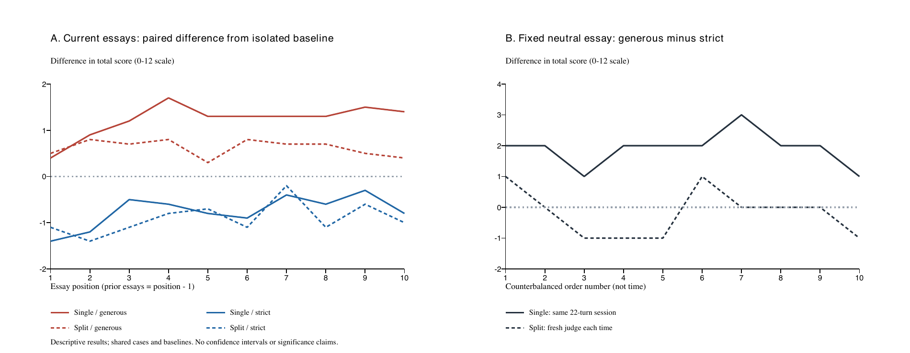

# Context History and Judge Isolation

한국어 합성 평가문을 사용해 **이전 입력의 평가 태도, 기록 재생, 실제 대화 누적, 판정 역할 분리**가 모델의 채점에 미치는 영향을 비교한 연구용 공개 준비 사본이다.

**라이선스는 아직 소유자가 선택하지 않았다.** [라이선스 상태](LICENSE-STATUS.md)를 먼저 확인한다. 이 폴더를 별도 GitHub 저장소의 루트로 사용하는 것을 전제로 구성했으며, 원본 작업 폴더 전체를 올리는 용도가 아니다.

## 연구 범위

| 연구 | 공개 선택 관측 | 핵심 비교 |
|---|---:|---|
| 실제 세션 주 실험 | 1,090 | 같은 세션에서 분석·판정을 누적 vs 지속 분석가와 매번 새 판정가 |
| 고정 이력 재생 | 720 | 단건 / 이전 글만 / 이전 글과 모델 평가 기록 |
| 누적 이력 재생 | 610 | 자기 평가 기록 누적과 동일 중립 글 분기 |

2,420개 관측을 모두 포함한다. 모델의 공개 최종 응답에서 점수·이유·분석 내용은 그대로 유지하고, 실제 공급자 세션 ID를 일관된 별칭으로 바꿨다. 원본 SDK 로그·개인 경로·초기 개인 지침·인증정보는 포함하지 않는다. [공개 범위와 변환 내역](docs/PUBLICATION.md)에 포함·제외 이유를 명시했다. [연구 변경 이력](docs/STUDY_HISTORY.md)과 [공개본 검증 결과](docs/PUBLICATION_CHECK.json)도 함께 제공한다.

자료와 코드는 AI의 도움을 받아 작성·검토했다. 모든 사례는 합성이며 실제 개인의 인사평가가 아니다. 주 모델은 연구 당시 계정에서 실행된 gpt-6-luna/medium이다. 모든 계정에서 같은 모델을 사용할 수 있다는 의미는 아니다.

## 최근 주 실험의 결과

같은 중립 글을 마지막에 평가한 평균이며 12점 만점이다. 각 조건은 10가지 순서의 결과다.

| 조건 | 중립 글 평균 |
|---|---:|
| 이력 없는 단건 | 9.90 |
| 실제 단일 세션 · 관대한 입력 이후 | 11.70 |
| 실제 단일 세션 · 엄격한 입력 이후 | 9.80 |
| 판정 분리 · 관대한 입력 이후 | 9.50 |
| 판정 분리 · 엄격한 입력 이후 | 9.70 |

순서별 관대−엄격 차이의 평균 절댓값은 단일1.90점, 판정 분리0.60점이다. 판정 분리의 절대차가 10개 순서 중8개에서 작았고2개는 같았다. 이는 이 자료에서 관측된 **맥락 민감도 차이**이며, 정답률이나 모든 멀티 에이전트의 우월성을 입증하지 않는다.



현재 글 원문과 사용자 평점100/70점, 논증 내용이 함께 달라지며 순수한 정서나 숫자 하나의 효과를 분리하지 않았다. 실제 정답 점수도 없다. 반복 글·기준선을 공유하므로 호출 수를 독립 표본 수로 해석하지 않는다. 단건은 분석 단계가 없어서 단건 대비 차이에는 분석 추가와 이력이 함께 포함된다.

## 바로 확인하기 — 모델 호출 없음

```sh
python3 tools/recompute.py
python3 -m unittest discover -s native/tests -v
python3 -m unittest discover -s tests -v
python3 tools/check_publication.py
```

출력은 gitignore된 build/에 생성된다. 로그인이나 API 키 없이 공개 관측을 재검산할 수 있다. 테스트는 가상 어댑터만 사용한다. 라이브 모델 호출은 기본 차단돼 있으며 [별도 실행 안내](docs/REPRODUCIBILITY.md)를 따른다.

## 디렉터리

- `native/`: 최신 실제 세션 실험 코드·테스트·합성 입력·익명화 관측·설계.
- `backend/`: 선택적인 Codex 연결 어댑터와 원래 버전의 의존성 목록. 설치물과 인증 캐시는 없음.
- `studies/replay-fixed/`, `studies/replay-cumulative/`: 앞선 수정 설계의 비교 데이터와 오프라인 집계 코드.
- `tools/`, `tests/`: 전체 공개 결과 재검산과 공개 범위 검사.
- `docs/`: 공개 결정, 재현 범위, 연구의 한계.

Native의 기술 점검10회와 원본 대화 증거는 관측표에 섞지 않았다. 앞선 두 연구는 사용자 승인 복구 후1,330개 배정의 결과를 확보했으며 실패30회의 추가 시도를 요약 원장에 공개한다. 실패 원본을 성공으로 덮어쓴 것이 아니다. 그 요약은 `studies/replay-execution-accounting.json`에 있다.

[연구 상세](native/PROTOCOL.md) · [재현 안내](docs/REPRODUCIBILITY.md) · [외부 의존성](THIRD_PARTY.md) · [라이선스 상태](LICENSE-STATUS.md)
