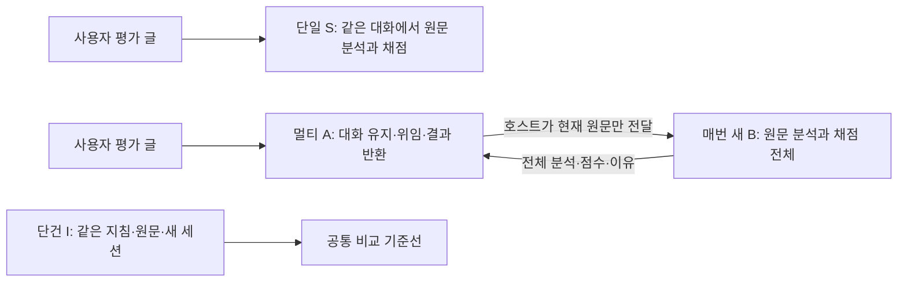
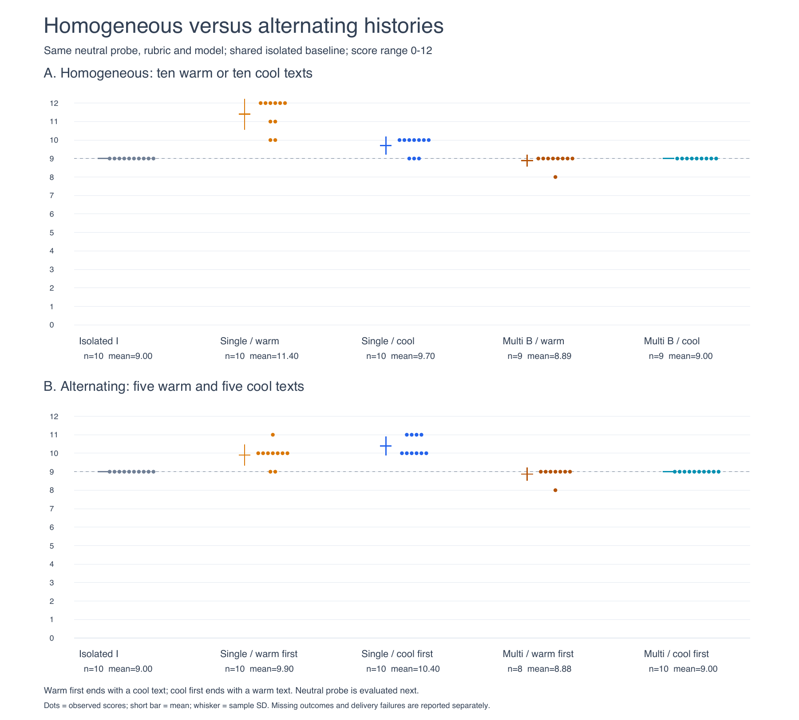

# Agent Context Experiments

**대화 이력을 유지하는 단일 평가자와, 사용자 대화 담당·독립 평가자를 분리한 구조에서 채점이 어떻게 달라지는지 비교한 연구다.** 한국어 합성 평가문을 사용하며, 점수는 사람의 성과가 아니라 글의 논증 품질을 나타내는 0–12점이다.

이 저장소는 **수정된 v4 설계의 동질 이력·교대 이력 두 실험**을 담는다. 이전 공개본의 ‘지속 분석가 + 새 점수 판정가’ 구조와 기록 재생 실험은 현재 자료에서 제외했다. 이전 커밋은 보존하며 [설계 변경 이유](docs/STUDY_HISTORY.md)에 구분했다.

## 무엇을 비교했나



B는 A가 작성한 분석문을 받아 점수만 매기는 역할이 아니다. **현재 원문을 직접 분석하고 채점한다.** A는 과거 사용자 글과 B의 전체 응답을 자신의 대화에 보관하지만, 그 이력을 다음 B에게 넘기지 않는다. S/B/I의 평가 지침·스키마·현재 원문은 같다. A가 ID를 지정하면 호스트가 원문과 결과를 그대로 전달한다.

- **동질 이력:** 관대한 글10개 또는 엄격한 글10개 → 동일 중립 글.
- **교대 이력:** 관대·엄격 각5개를 교대로 평가 → 동일 중립 글. 관대 시작·엄격 시작을 구분한다.
- 각 조건10가지 순서. S는 세션당11턴, A는22턴, B는 매번1턴. 중립 글은 마지막에만 넣었다.
- 모델은 연구 당시 계정에서 사용한 `gpt-6-luna / medium`이다. 글 속 100점·70점과 모델의 논증 품질0–12점은 별개다.

## 같은 중립 글의 결과

단건 기준선은 **9.00 ± 0.00점(n=10)**이다. 아래 ±는 표본 표준편차다. 결측을0점으로 처리하지 않았다.

| 이력 | 단일 S | 새 평가자 B |
|---|---:|---:|
| 관대만10개 | 11.40 ± 0.84 (n=10) | 8.89 ± 0.33 (n=9) |
| 엄격만10개 | 9.70 ± 0.48 (n=10) | 9.00 ± 0.00 (n=9) |
| 교대·관대 시작 → 마지막 엄격 | 9.90 ± 0.57 (n=10) | 8.88 ± 0.35 (n=8) |
| 교대·엄격 시작 → 마지막 관대 | 10.40 ± 0.52 (n=10) | 9.00 ± 0.00 (n=10) |



**교대해도 단일의 점수는 단건보다 높았다.** 누적 중 현재 글의 단건 대비 변화는 단일에서 관대한 글−0.17점, 엄격한 글+1.48점이었다. B에서는 각각−0.05점과+0.12점이었다. 전체 평균만 보면 이런 글 유형별 차이를 놓칠 수 있다.

이 결과는 평가 맥락의 격리와 점수 안정성을 뒷받침한다. 인간 정답이 없어 정확도 우열은 확정할 수 없으며, 에이전트 수 자체가 지능을 높였다는 증거도 아니다. [종합 결과와 한계](reports/RESULTS.md)에 공통 완료 반복, 점수 편차, 단계별 변화, 반환 성공까지 제한한 비교를 정리했다.

## 실행 수와 실패

| 실험 | 새 배정 | 완료 | 실패 | 후속 차단 | 유효한 전체 평가 |
|---|---:|---:|---:|---:|---:|
| 동질 이력 | 1,090 | 1,069 | 3 | 18 | 644 (단건210 포함) |
| 교대 이력 | 880 | 861 | 3 | 16 | 434 |
| 중복 제거 합계 | 1,970 | 1,930 | 6 | 34 | 1,078 |

교대 실험은 동질 실험의 단건210건을 재사용했다. 이를 새 호출이나 별도 표본으로 세지 않는다. 실패는 ID 끝부분 누락5건과90초 시간 초과1건이며, 모두 A에서 발생했다. B의 채점 완료와 사용자 반환 성공은 따로 센다. 반환은 동질211/220건, 교대213/220건이었다.

동질 실험의 호스트 중단으로 제외된 추가 시도9건과 기술 점검9건은 위 관측표 밖의 [실행 원장](reports/execution-accounting.json)에 포함했다. 실패를 성공으로 바꾸거나 유리한 점수만 고르지 않았다.

## 모델 호출 없이 재검산

Python 표준 라이브러리로 실행한다. 로그인·API 키·패키지 설치가 필요 없다.

```sh
python3 tools/recompute.py
python3 -m unittest discover -s tests -v
python3 -m unittest discover -s experiments/homogeneous/tests -v
python3 -m unittest discover -s experiments/alternating/tests -v
python3 tools/check_publication.py
```

재계산 결과는 `build/recomputed-summary.json`에 생성된다. 테스트에는 가상 어댑터만 사용한다. 역할 계약과 실행기 코드는 공개하지만, 개인 지침·원본 SDK 로그·실제 공급자 세션 ID·인증 캐시는 제외했다. [재현 범위](docs/REPRODUCIBILITY.md)와 [공개 범위·변환](docs/PUBLICATION.md)에 제한을 명시했다. 이 게시 작업에서 추가 모델 실험은 실행하지 않았다.

## 파일 안내

- [종합 결과](reports/RESULTS.md) · [실험 방법](docs/METHODS.md) · [설계 변경 이력](docs/STUDY_HISTORY.md)
- `experiments/homogeneous/`: 동질 설계·원문·역할 계약·실행 코드·1,090개 공개 기록.
- `experiments/alternating/`: 교대 설계·코드·새880개 공개 기록. 기준선은 동질 파일에서 참조.
- `reports/`: 비교 그림, 집계 JSON, 추가 시도 원장.
- `tools/`, `tests/`: 오프라인 재계산·관계 무결성·공개 범위 검사.
- `backend/`: 선택적 SDK 어댑터와 고정 의존성 목록. 라이브 연결은 기본 차단.

모든 사례는 합성이며, 코드·자료·분석은 AI의 도움을 받아 작성·검토했다. [프로젝트 라이선스는 미지정](LICENSE-STATUS.md)이며, [외부 의존성](THIRD_PARTY.md)의 라이선스와 구별한다.
